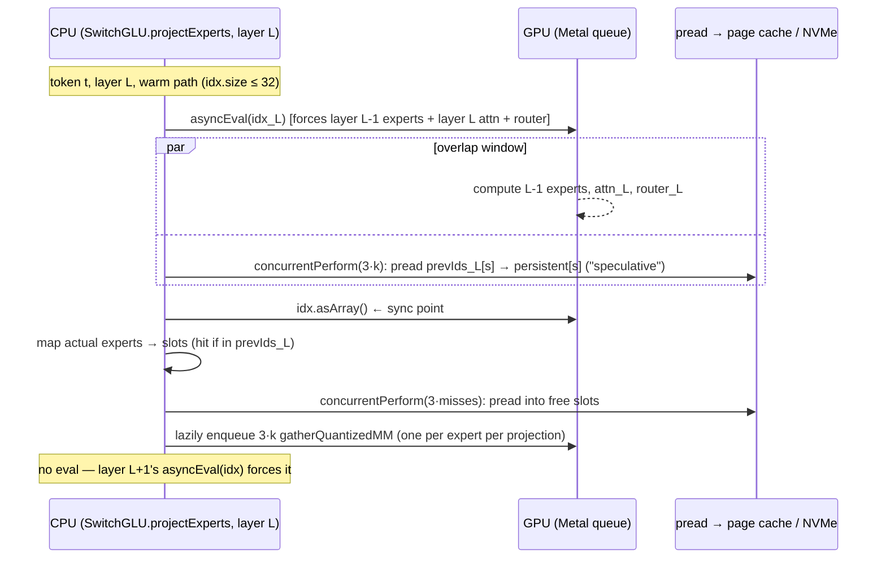

# SSD Weight Streaming — Current Architecture (Phase 0 survey)

Status: survey of `SharpAI/SwiftLM@20ee3d0` with submodules
`mlx-swift@3185383` and `mlx-swift-lm@87232e7`. Nothing in this document
describes new code. It records what exists today, so later phases can be
measured against it.

**Scope (decided 2026-10-27): MoE models only.** Dense layer streaming and
the dense activation-sparsity predictor are out of scope. A dense model that
does not fit in RAM must read all its weights for every token, which is
about a minute per token on this SSD for a 400 GB model.

`docs/moe_ssd_streaming_architecture.md` is older and partly stale. Where it
disagrees with this file, this file was checked against the source.

## 1. Repository layout that matters for streaming

```
SwiftLM/                                  (this repo)
├── Sources/SwiftLM/Server.swift          CLI flags, memory budget, draft cap, activation
├── Sources/MLXInferenceCore/             SwiftBuddy/iOS engine (same switches)
├── mlx-swift-lm/   (git submodule, SharpAI fork)
│   └── Libraries/MLXLMCommon/
│       ├── ExpertStreamingConfig.swift   global mode: disabled / mmapPageCache / directNVMe
│       ├── Load.swift                    lazy load, skip expert weights, shard map
│       ├── SwitchLayers.swift            SwitchGLU / SwitchLinear: ALL live streaming logic
│       ├── LayerPartitioning.swift       StreamableMoE, LayerPartitionable, partitionedLayerCall
│       └── ModelContainer.swift          setStreamExperts → finds StreamableMoE in module tree
│   └── Libraries/MLXLLM/Models/*.swift   per-model wiring (Qwen35 has SWIFTLM_TOP_K)
└── mlx-swift/      (git submodule, SharpAI fork)
    ├── Source/MLX/MLXFast.swift          Swift wrappers: preadInto, preadIntoOffset, setPrefetchEnabled
    └── Source/Cmlx/                      *vendored* (not submodules) mlx + mlx-c sources
        ├── mlx-c/mlx/c/fast.cpp          mlx_fast_pread_into[_offset], PAPPS pool  ← live
        └── mlx/mlx/core/moe_stream_op.*  LoadSSDExpert primitive                   ← dead
            mlx/mlx/backend/metal/ssd_streamer.*, kernels/moe_stream.metal         ← dead
```

**Contradiction with the task brief and `.agents/workflows/mlx-upstream-sync.md`:**
`mlx` and `mlx-c` are not submodules of `mlx-swift`. They are vendored into
`mlx-swift/Source/Cmlx/` (there is no `mlx-swift/.gitmodules`). An edit "in
the mlx submodules" therefore means a commit to the `SharpAI/mlx-swift` fork.
There is no `fence.air`. `mlx/backend/metal/fence.cpp` is upstream MLX code,
not a SharpAI patch.

## 2. What is actually on the live path

Only one SharpAI C++ patch is live: `mlx_fast_pread_into` and
`mlx_fast_pread_into_offset` in `mlx-c/mlx/c/fast.cpp`. Each call does this:

1. It looks up `(fd, data_start, bytes_per_expert)` for `path|tensorName` once
   and caches it. The safetensors header is parsed with nlohmann::json.
2. It computes `offset = data_start + expert × bytes_per_expert`.
3. It runs a synchronous `pread(fd, arr.data(), nbytes, offset)` straight into
   the data pointer of an MLX array that has already been evaluated. MLX is
   not told that the memory changed.

Everything else — choosing experts, buffers, overlap, prediction — is Swift
in `SwitchLayers.swift`. That is good for the "do it in Swift" constraint.
The work can stay at the Swift level, as long as the `pread_into` primitive
stays as it is.

Dead or unwired code (it compiles but nothing reaches it):

| Code | Why it is dead |
|---|---|
| `LoadSSDExpert` / `streamed_gather_mm` / `SSDStreamer` (`ssd_streamer.mm`) | `MLXFast.streamedGatherMM` has no callers. |
| `moe_stream.metal` `streamed_moe_gemm` | Never dispatched. It is a naive 4-bit kernel with no scales. |
| PAPPS 16-thread pool (`--ssd-prefetch`) | The pool starts, but the only submitter (`pappsPrefetch` in `QuantizedSwitchLinear.callAsFunction`) is commented out. `try_take` never hits. |
| `SSDStreamMetrics.record` | Its body logs nothing. Live metrics come from `mlx_ssd_metrics_snapshot` in `moe_stream_op.cpp`, which only `LoadSSDExpert` feeds, so `/metrics` SSD counters stay at zero on the live path. *(To verify in the smoke run.)* |

## 3. Data flow for one decode token (default path)



Per-layer state in `SwitchGLU` (default path):

* `_persistentGate/Up/Down: [MLXArray]`: `k` separate `[1, out, in]`
  quantized buffers for each projection. They are allocated and evaluated on
  the first token. They regrow if a call routes more experts (MTP verify).
* `_previousExpertIds`: last token's routing for this layer. It is the only
  predictor.

Measured behaviour that differs from the comments:

* **There is no cache between tokens on the default path.** The
  "speculative" step re-preads *all* `prevIds` into slots `0..<k` every
  token, whether or not those slots already hold them. A "hit" means the read
  ran inside the overlap window. It does not mean a read was saved. SSD bytes
  per token are about `k + misses` experts per layer, not `misses`.
* **"QD≈24" is `DispatchQueue.concurrentPerform(iterations: 3·k)`.** It is
  not a configurable queue depth. Its width follows top-k and is capped by the
  GCD worker count (CPU cores). It is also two bursts: speculative, then
  misses.
* **"Direct NVMe, bypasses the page cache" is false.** The fd is opened with
  plain `O_RDONLY`, and there is no `F_NOCACHE`, `F_RDAHEAD` or `madvise`
  anywhere. Every pread goes through the macOS unified buffer cache. Today's
  system is the "let the OS page cache do it" policy, reached through `pread`
  instead of `mmap`. Any RAM the OS lets the page cache keep becomes a
  free expert cache that the app cannot see.

### Opt-in stacked path (`MLX_MOE_STACKED=1`, `MLX_MOE_FUSE_GATEUP=1`)

`runStackedFastPath` keeps one `[CACHE_SLOTS, out, in]` buffer per projection
(`MLX_MOE_CACHE_SLOTS`, default 16, minimum 6). Experts stay resident across
tokens. Eviction is **LRU** by per-layer token counter. The same prev-token
prediction pre-claims slots, but only for experts that are not already
resident, so it does save reads. Compute is one `gatherQuantizedMM` per
projection (two if gate and up are fused). On misses it runs
`Stream.gpu.synchronize()` and a per-miss `print` to stdout. This is the
nearest thing to a managed cache in the codebase, and it is off by default.

### Prefill path (`idx.size > 32`)

`MLX.eval(idx)`, then fresh buffers for the experts in use, then one
concurrent pread burst. Nothing persists. Qwen3.5 also evals and synchronizes
around each MoE block during prefill (`needsMoeFlush`).

## 4. Load and activation

1. `--stream-experts` → `Server.swift`:
   * MoE check through `ModelProfiler`. For a dense model the flag is silently
     turned off. **No dense streaming exists.**
   * `ExpertStreamingConfig.activate(dir, useDirectIO: true)`
   * `MLX_MAX_OPS_PER_BUFFER=50`
   * `Memory.cacheLimit = 0.85·RAM − 4 GB − draft`. `memoryLimit` is a
     200 GB sentinel, or `1.1·RAM` when a draft model would overcommit.
   * `--parallel` is forced to 1, because there is one persistent buffer set
     per layer.
   * `--draft-model` with `--stream-experts` caps `--num-draft-tokens` to 1.
     **`--mtp` and `--dflash` are not capped.** MTP verify regrows the
     persistent buffers instead (`persistentBufferPlan`).
2. `Load.swift` with `streamsThisModel`:
   * `loadModelCheckpointLazily`: every tensor is an unevaluated `Load` node.
   * `ExpertStreamerManager.shared` = `weight_map` from
     `model.safetensors.index.json`.
   * Sets `tensorName` on each `SwitchLinear` (or `unstackedSSDMap` for
     per-expert checkpoints).
   * `materializeNonExpertWeights`: evaluates everything except
     `SwitchLinear.weight`. **Expert scales and biases stay resident.** Only
     the packed weight streams.
3. `container.setStreamExperts(true)`: sets `streamExperts` on the first
   `StreamableMoE` it finds. `partitionedLayerCall` then *skips* its per-layer
   eval while SSD streaming is on, because the next layer's `asyncEval(idx)`
   forces the previous one.

Models that adopt `StreamableMoE`: Qwen3MoE, Qwen35/Qwen35MoE (+VLM),
Qwen3Next, DeepseekV3/V32/V4, GLM4MOELite, GPTOSS, Jamba, LFM2MoE, MiMoV2Flash,
Mistral4, OlmoE, Gemma4 (VLM). Some other `SwitchGLU` users (Mixtral,
DeepseekV2, MiniMax, PhiMoE, GLM4MOE, BailingMoe, AfMoE, GraniteMoeHybrid) do
not adopt `StreamableMoE`. `SwitchGLU` gates on the global
`ExpertStreamingConfig`, not on `streamExperts`, so these models probably
stream anyway while `setStreamExperts` reports "not supported". *(Not
verified. Read from the code, not run.)*

## 5. Runtime knobs (as found)

| Knob | Scope | Effect |
|---|---|---|
| `--stream-experts` | CLI | Everything above. |
| `--ssd-prefetch` | CLI | Starts the PAPPS pool. **No effect** (no submitter). |
| `SWIFTLM_TOP_K` | env | Top-k override, **Qwen35 sparse-MoE block only**. Clamped to ≤ config k. |
| `MLX_MOE_CACHE_SLOTS` | env | Slot count for the stacked path only. |
| `MLX_MOE_STACKED`, `MLX_MOE_FUSE_GATEUP` | env | Turn on the stacked LRU path and the fused gate+up path. |
| `MLX_MOE_DECODE_FLUSH` | env | Qwen35: per-layer eval+sync on decode too. |
| `--turbo-kv`, per-request `kv_bits` | CLI/API | Independent of streaming. `--turbo-kv` does nothing with `--ctx-size` (RotatingKVCache). |
| `--gpu-layers` | CLI | CPU/GPU layer split. Bypassed when streaming. The only existing "dense > RAM" story. |
| `--info` | CLI | `ModelProfiler.plan` report (fullGPU / swapAssisted / layerPartitioned / tooLarge). Groundwork for the Phase 3 cache report. |

## 6. Flags against the project brief

1. **mlx/mlx-c are vendored, not submodules** (see §1). Any C++ change is an
   `mlx-swift` fork commit. The sync doc is out of date.
2. **`ssd_streamer.mm` / `fence.air` do not enable the current path.**
   `ssd_streamer.mm` is dead and `fence.air` does not exist. The live
   primitive is ~40 lines of `pread` in `mlx-c/fast.cpp`.
3. **"App-level LRU regressed" is only partly true in the code.** The LRU
   still ships, opt-in, as the stacked path. The default path has *no*
   cross-token cache, but it gets one for free from the OS page cache, because
   there is no `F_NOCACHE`. A fair managed-vs-OS comparison needs a
   `F_NOCACHE` toggle. Without it, "managed cache" is measured on top of an
   OS cache that is also working.
4. **`StreamableUnit` as one contiguous `(byteOffset, byteLength)` does not
   fit an expert.** An expert is 3 ranges (gate, up, down weight; possibly
   in different shards). The unit needs a list of `(file, offset, length)`
   extents, with each extent mapped to a slot in a destination buffer.
5. **Top-k override is not general.** It exists only in Qwen35's MoE block.
6. **Speculative-decoding caps only cover `--draft-model`.** MTP and DFlash
   with streaming are uncapped.
7. **Test machine.** M3 Ultra, **256 GB** unified memory, internal SSD. Any
   MoE model under ~250 GB ends up fully in the page cache. Honest streaming
   numbers need a >256 GB MoE checkpoint, or forced cold reads
   (`F_NOCACHE` plus a hard cap on the resident budget).
8. **Correctness hazard to carry into the redesign.** `pread_into` mutates
   evaluated arrays behind MLX's back. That is safe today only because each
   layer's buffers are written while nothing in flight reads them (token
   ordering plus the `idx` readback). Prefetching further ahead (the next
   layer's experts, or a resident hot set that is rewritten) breaks that
   assumption. Overwriting a slot needs an explicit "GPU finished with it"
   fence (`MTLSharedEvent` or a completion handler), not a global
   `Stream.gpu.synchronize()`.
9. **Dispatch count.** The default path issues 3·k `gatherQuantizedMM` per
   layer (24 at k=8). The stacked path cuts this to 2–3. Any port to
   `StreamEngine` should keep the stacked layout available. Otherwise dispatch
   overhead, not I/O, may set the ceiling on a fast SSD.

## 7. Baseline measurements (this machine)

Machine: Mac Studio M3 Ultra, 256 GB, macOS 27.0.1, Xcode 27.0, Swift 6.4.
Build: `./build.sh` passes (after `xcodebuild -downloadComponent MetalToolchain`).

Tests:
* `make test`: 326 executed, 0 failures, 15 skipped.
* mlx-swift-lm `xcodebuild test`: **fails in parallel mode**. Unrelated
  suites crash the shared xctest process with a Metal assertion
  (`_status < MTLCommandBufferStatusCommitted`), and the tests that were in
  flight are reported as failed (KVCache/TurboKV, TurboFlashAttention,
  Gemma3n, VLM continuation, speculative). Run serially
  (`-parallel-testing-enabled NO`), the same suites pass. All streaming
  suites pass either way (`SSDPersistentBuffer*`, `Qwen35MoeFlushGate`,
  `CorruptSafetensors`, `StreamingFinalization`).

Model: `mlx-community/Qwen3.6-35B-A3B-4bit`. 40 layers, 256 experts, top-8,
hidden 2048, moe_intermediate 512. 20.4 GB on disk: 16.1 GB expert weights
(streamed), 2.0 GB expert scales and biases (resident), 2.3 GB other
(resident). One expert = 3 × 512 KB = **1.5 MB**. Minimum streamed per token
= 40 × 8 × 1.5 MB = **480 MB** (the default path re-reads all k every token).

Decode benchmark: `scripts/profiling/phase0_baseline.sh`, temperature 0,
seed 1234, 3 prompts × 3 runs × 256 tokens. Warm page cache: the model files
were already in the unified buffer cache.

| config | decode tok/s median [min–max] | TTFT | peak RSS | MLX peak | disk0 read during bench |
|---|---|---|---|---|---|
| resident (no streaming) | **79.1** [78.0–79.6] | 0.08 s | 18.1 GB | 19.9 GB | 0.02 GB |
| `--stream-experts` | **16.1** [16.0–16.3] | 0.62 s | 4.3 GB | 4.2 GB | 0.01 GB |
| + `MLX_MOE_STACKED=1` (LRU, 16 slots) | 19.9 [19.7–20.5] | 0.61 s | 4.8 GB | 4.7 GB | 0.01 GB |
| + `SWIFTLM_TOP_K=4` | 20.5 [20.4–20.8] | 0.44 s | 4.9 GB | 5.6 GB | 0.01 GB |

Cold SSD random read: `scripts/profiling/ssd_read_bench.py`, `F_NOCACHE`,
checked against iostat disk0. QD1 2.1 GB/s. **QD ≥ 6: 6.57 GB/s** at both
512 KB and 1.5 MB blocks.

What the numbers say:

1. **The warm streaming numbers measure overhead, not I/O.** The disk read
   0.01 GB while the benchmark streamed ~1.1 TB worth of expert reads
   (≥480 MB/token). Every pread was a memcpy from the page cache. The
   79 → 16 tok/s gap (≈50 ms per token, ≈1.2 ms per layer) is Swift-side
   orchestration: a CPU readback of `idx` in every layer, 24 concurrent
   preads (memcpy), and 24 `gatherQuantizedMM` dispatches. The stacked path
   cuts dispatches and gains 24% even though it does a full
   `Stream.gpu.synchronize()` plus a stdout `print` on almost every
   layer-call (89,022 "SSD Sync" lines in ~2.3k tokens × 40 layers). Its
   16-slot LRU rarely saves a read at k=8.
2. **Cold ceiling for this model on this SSD.** 6.57 GB/s ÷ 0.48 GB =
   **13.7 tok/s at k=8**, and 27 tok/s at k=4, if no expert is ever cached.
   The warm stream number (16.1) is already above that ceiling, which is
   only possible because of the page cache. A real streaming scenario
   (model > free RAM) runs below 13.7 unless a cache holds the hot experts.
3. **Streaming does not reproduce resident output bit for bit.** Streaming
   computes each expert with its own `gatherQuantizedMM`, while resident
   runs one batched gather, so rounding differs. At temperature 0 the text
   diverges within the first 5–300 characters. Both outputs read fine. Every
   streaming config is deterministic across runs. Phase 1's "identical
   output" check must compare streaming before and after, not streaming
   against resident.
4. **`/metrics` SSD counters read 0** in every streaming config, as §2
   predicted.
5. Not measured: cold-cache streaming (needs `sudo purge`; the script
   supports `PURGE=1`), and long-context or TurboKV interaction.
